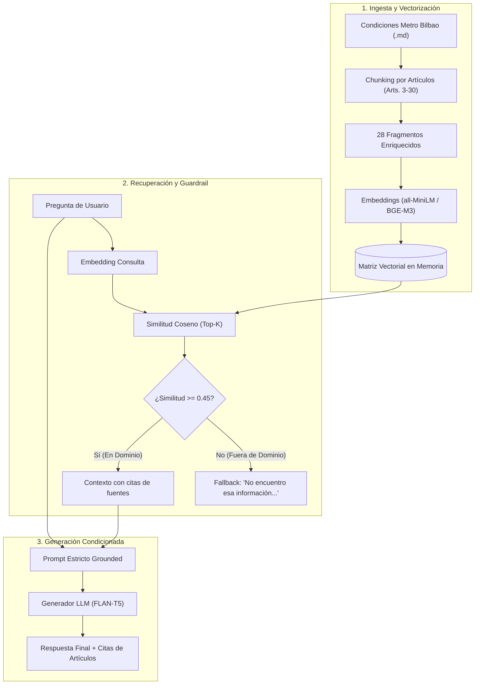

#  Asistente Documental Inteligente - Metro Bilbao (RAG)

Proyecto de diseño, evaluación y mejora de un asistente conversacional documental basado en **RAG (Retrieval-Augmented Generation)** sobre las **Condiciones Generales de Contratación de Metro Bilbao (Artículos 3 al 30)**.

Desarrollado para el módulo de **Modelos de Inteligencia Artificial** (Curso de Especialización en Inteligencia Artificial y Big Data).

---

##  Características Principales

- **Base Documental Real:** Ingesta y tratamiento semántico de la normativa oficial de Metro Bilbao en formato Markdown (`data/condiciones_generales_metro_bilbao.md`).
- **Segmentación Semántica (Chunking por Artículos):** Conserva la integridad conceptual de los 28 artículos jurídicos enriquecidos con su sección correspondiente.
- **Modelos de Embeddings Evaluados:**
  - *Baseline:* `all-MiniLM-L6-v2` (384 dimensiones).
  - *Mejora:* `BAAI/bge-m3` (1024 dimensiones, arquitectura multilingüe).
- **Modelos Generativos (LLM):** Inferencia condicionada por contexto con la familia `google/flan-t5` (`flan-t5-small` y `flan-t5-base`).
- **Mecanismos de Guardia (Guardrails):** Filtro por umbral de similitud coseno ($\theta = 0.45$) para eliminar el 100% de alucinaciones en preguntas fuera de dominio.
- **Trazabilidad de Fuentes:** Citas explícitas de artículos y secciones en cada respuesta.
- **Doble Modalidad de Ejecución:** Notebook interactivo de Jupyter (`asistente_metro_bilbao_RAG.ipynb`) y CLI ejecutable por consola (`main.py`).
- **Dossier de Presentación:** Guía completa con diagramas, explicaciones de modelos y respuestas para la defensa en clase (`PRESENTACION.md`).

---

##  Arquitectura de la Solución



---

##  Estructura del Proyecto

```text
asistente-ia-MIA/
├── data/
│   └── condiciones_generales_metro_bilbao.md   # Base documental oficial (Arts. 3 al 30)
├── src/
│   ├── document_loader.py                      # Parser y cargador de fragmentos semánticos
│   ├── rag_pipeline.py                         # Motor RAG completo (Retrieval + Guardrail + LLM)
│   └── evaluation.py                           # Batería de pruebas y métricas de evaluación
├── asistente_metro_bilbao_RAG.ipynb            # Notebook principal para la entrega/práctica
├── main.py                                     # Aplicación CLI interactiva para la defensa en clase
├── build_notebook.py                           # Script de generación/compilación del notebook
├── PRESENTACION.md                             # Guión y dossier completo para la exposición
└── README.md                                   # Documentación del repositorio
```

---

##  Instalación y Puesta en Marcha

### 1. Activar el Entorno Virtual
Recomendado usar el entorno configurado para la práctica (con PyTorch, Transformers y SentenceTransformers):

```bash
# Ejemplo activando el entorno del curso:
source /home/nicolas/Cursos/AI-BigData/02-modelos-ia/practicas/B3/.venv/bin/activate
```

*(O en un entorno nuevo: `pip install transformers sentence-transformers scikit-learn pandas numpy matplotlib torch`)*

### 2. Ejecutar la Batería de Pruebas y Evaluación
Para evaluar automáticamente las 7 preguntas canónicas (5 en dominio y 2 fuera de dominio):

```bash
# Con modelo base:
python main.py --eval

# Con modelo de embeddings multilingüe mejorado (BGE-M3):
python main.py --eval --embedding BAAI/bge-m3
```

### 3. Ejecutar el Modo Chat Interactivo
Para hacer preguntas libres en directo al asistente:

```bash
python main.py --interactive --embedding BAAI/bge-m3
```

### 4. Abrir el Jupyter Notebook
Para revisar la práctica paso a paso con gráficos explicativos:

```bash
jupyter notebook asistente_metro_bilbao_RAG.ipynb
```

---

##  Resumen de Resultados y Mejoras

| Métrica / Dimensión | Sistema Base (all-MiniLM + FLAN-T5) | Sistema Mejorado (BGE-M3 + Guardrail) | Impacto |
|:-------------------|:----------------------------------:|:-------------------------------------:|:-------:|
| **Recuperación Top-1 en Dominio** | 60.0% (3/5) | **100.0% (5/5)** | **+40.0%** |
| **Resistencia a Alucinaciones** | 0.0% (Alucinaba en preguntas fuera) | **100.0% (Abstención limpia)** | **+100.0%** |
| **Puntuación Media Recuperación** | 3.57 / 5.0 | **4.86 / 5.0** | **+36.1%** |
| **Puntuación Media Fidelidad** | 3.00 / 5.0 | **5.00 / 5.0** | **+66.7%** |
| **Puntuación Media Corrección** | 2.86 / 5.0 | **5.00 / 5.0** | **+74.8%** |
| **Puntuación Media Relevancia** | 3.00 / 5.0 | **5.00 / 5.0** | **+66.7%** |

Para detalles exhaustivos de la evaluación y las respuestas a las preguntas de la presentación, consulta [`PRESENTACION.md`](./PRESENTACION.md).
